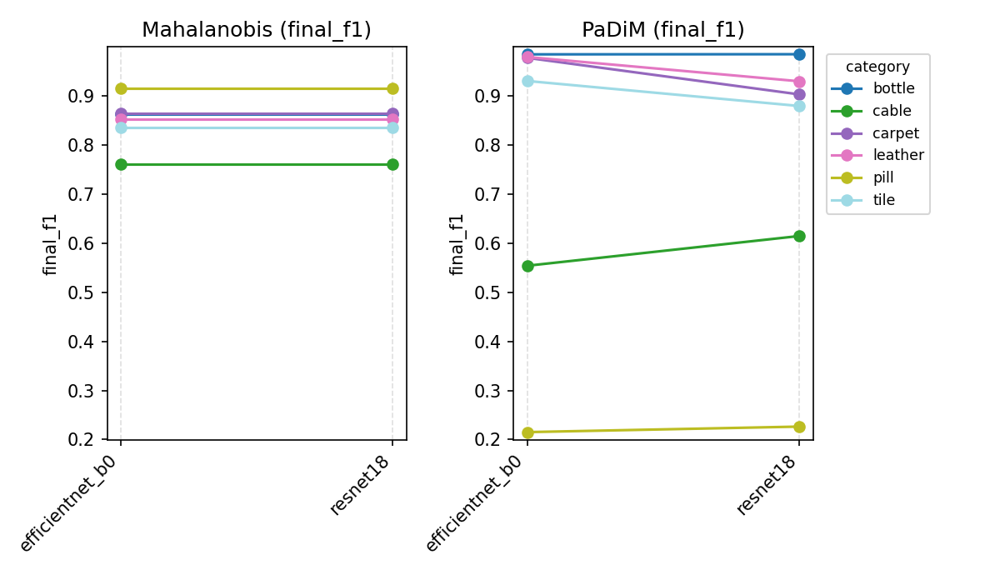
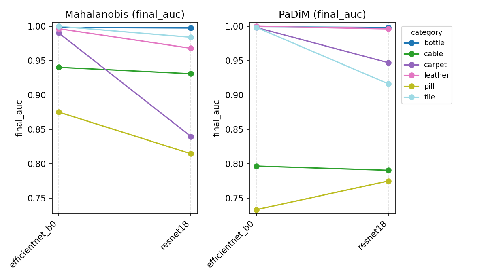
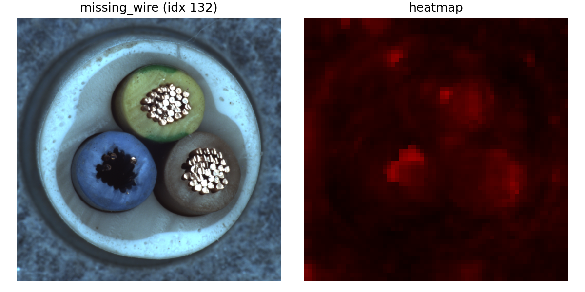
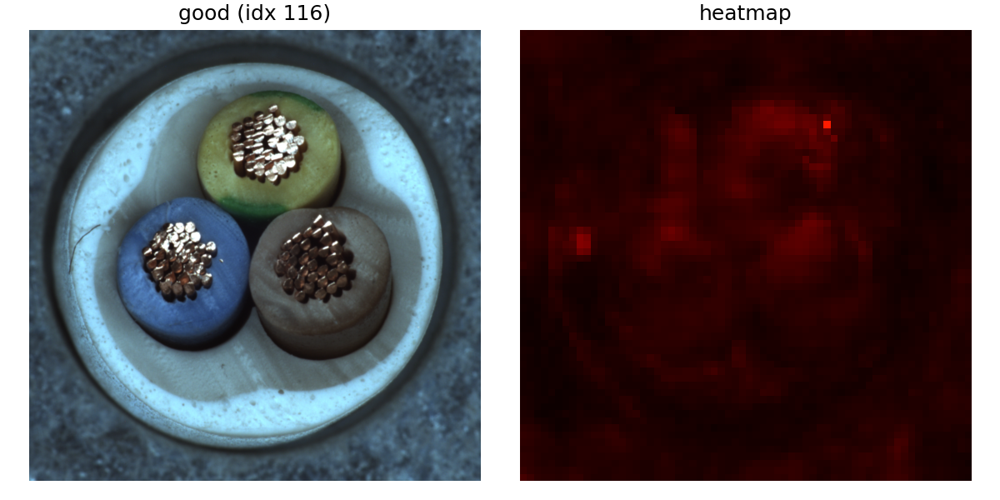
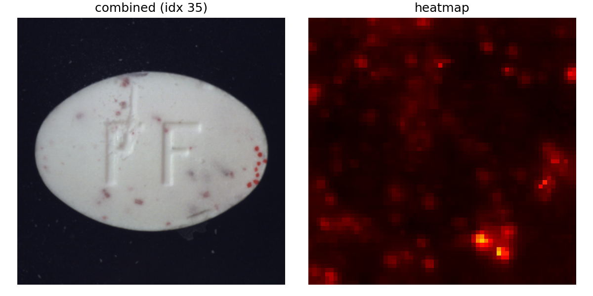
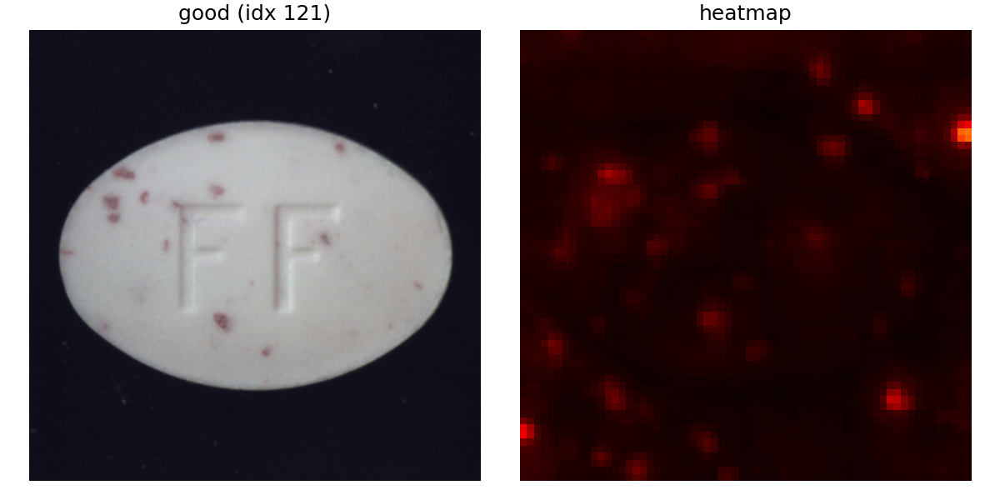
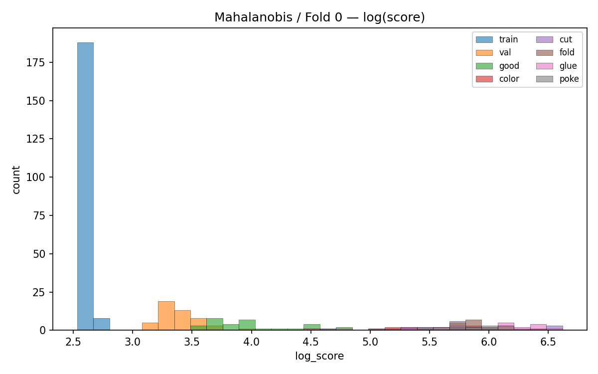
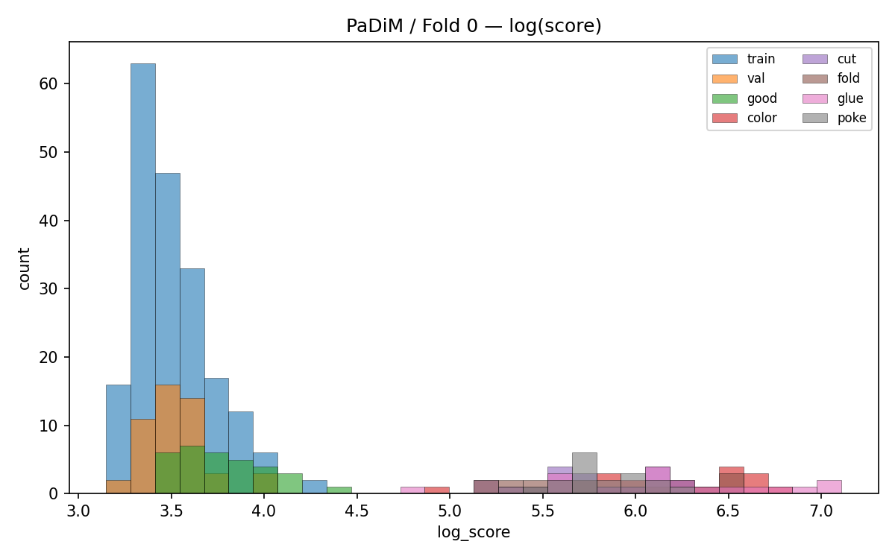

# 実験レポート — MVTec 画像異常検知

## 目的と前提
- 目的: 画像データの異常検知タスクにおいて、2つの手法（Mahalanobis 距離法 / PaDiM）および2つのバックボーン（ResNet18 / EfficientNet‑B0）で性能を比較する。
- 前提: 異常データが得られない、あるいは正常に比べて極めて少数、または未知の異常（観測済みのどの異常にも分類不能）が発生する状況を想定。よって、学習には学習用正常データのみを使用し、正常データの分布推定（共分散行列など）を行い、正常・異常の閾値設定は Out Of Fold（OOF）の異常スコアに基づいて行った。

## データと実験条件
- データ: MVTec AD（カテゴリ: carpet, leather, tile, bottle, cable, pill）
  - カテゴリ選定理由: テスクチャ系で3カテゴリ（carpet, leather, tile）、オブジェクト系で3カテゴリ（bottle, cable, pill）を選定。
- バックボーン: `resnet18`, `efficientnet_b0`
- 手法: Mahalanobis距離法, PaDiM
- 検証手順（experiment.ipynb 内 `run_pipeline`）
  - K‑Fold で学習用データ（train/good）を分割し、フォールドごとに学習と異常スコアを取得。
  - 全フォールドのOOF異常スコアを結合し正規化。その 99% 分位点を正常・異常の閾値 `z_threshold` として決定。
  - 全 train/good で最終モデルを学習し、テストデータ（test）でAUCおよびF1スコアを算出。
  - 結果保存先: `results/<timestamp>/<backbone>/<category>/<method>/`
  - 集計: `results/<timestamp>/sweep_summary.csv`

## 手法の要点
### 異常スコア算出アルゴリズム
- Mahalanobis距離法
  - 正常画像のみから得た特徴量の分布（平均および共分散）を学習し、新規画像の特徴がその分布からどれだけ離れているかをMahalanobis距離によりスコア化。
  - 事前学習済みバックボーンの最終層手前の出力を特徴量に使用。
  - スクリプト: `anomaly_detectors/mahalanobis.py`
  - 参考文献: 1. Modeling the Distribution of Normal Data in Pre-Trained Deep Features for Anomaly Detection
- PaDiM
  - 画像の各位置（パッチ）ごとに多変量正規分布（平均および共分散）を学習し、テスト時に各パッチのマハラノビス距離を計算。
  - バックボーンの空間特徴を複数の中間層から取得し、同一サイズへ補間してチャネル方向に結合（パッチ表現を形成）したものをパッチの特徴量として扱う。
  - 画像レベルの異常スコアは全パッチのマハラノビス距離の最大値で算出。
  - 位置ごと（パッチごと）の異常度を算出するため、ヒートマップで異常部分を可視化可能。
  - スクリプト: `anomaly_detectors/padim.py`
  - 参考文献： 2. PaDiM: a Patch Distribution Modeling Framework for Anomaly Detection and Localization
### 閾値設定
- フォールドごとの OOF 異常スコアを結合し、正規化後の 99% 分位点を保存。最終モデル側でも学習異常スコア（μ, σ）で z 化し、`z > z_threshold` を異常判定に適用。

## 結果
- 結果一覧

| category | backbone | method | final_auc | final_f1 | z_threshold |
| --- | --- | --- | --- | --- | --- |
| bottle | resnet18 | Mahalanobis | 0.9976 | 0.8630 | 3.8853 |
| bottle | resnet18 | PaDiM | 0.9984 | 0.9844 | 3.6705 |
| bottle | efficientnet_b0 | Mahalanobis | 0.9984 | 0.8630 | 3.0976 |
| bottle | efficientnet_b0 | PaDiM | 0.9992 | 0.9841 | 3.5954 |
| cable | resnet18 | Mahalanobis | 0.9310 | 0.7603 | 3.0429 |
| cable | resnet18 | PaDiM | 0.7907 | 0.6144 | 2.8945 |
| cable | efficientnet_b0 | Mahalanobis | 0.9404 | 0.7603 | 2.2203 |
| cable | efficientnet_b0 | PaDiM | 0.7969 | 0.5538 | 3.0649 |
| carpet | resnet18 | Mahalanobis | 0.8399 | 0.8641 | 3.1653 |
| carpet | resnet18 | PaDiM | 0.9470 | 0.9026 | 3.3710 |
| carpet | efficientnet_b0 | Mahalanobis | 0.9904 | 0.8641 | 3.5700 |
| carpet | efficientnet_b0 | PaDiM | 0.9984 | 0.9770 | 4.7118 |
| leather | resnet18 | Mahalanobis | 0.9681 | 0.8519 | 3.2997 |
| leather | resnet18 | PaDiM | 0.9963 | 0.9293 | 4.0337 |
| leather | efficientnet_b0 | Mahalanobis | 0.9966 | 0.8519 | 3.6532 |
| leather | efficientnet_b0 | PaDiM | 1.0000 | 0.9787 | 3.2359 |
| pill | resnet18 | Mahalanobis | 0.8148 | 0.9156 | 2.6377 |
| pill | resnet18 | PaDiM | 0.7752 | 0.2264 | 3.1921 |
| pill | efficientnet_b0 | Mahalanobis | 0.8753 | 0.9156 | 3.0507 |
| pill | efficientnet_b0 | PaDiM | 0.7335 | 0.2152 | 3.8510 |
| tile | resnet18 | Mahalanobis | 0.9841 | 0.8358 | 2.5645 |
| tile | resnet18 | PaDiM | 0.9163 | 0.8790 | 3.7345 |
| tile | efficientnet_b0 | Mahalanobis | 1.0000 | 0.8358 | 4.4713 |
| tile | efficientnet_b0 | PaDiM | 0.9986 | 0.9299 | 4.3921 |

※ `results/dev/202509231457/sweep_summary.csv` より

- 手法平均（全カテゴリ・全バックボーンの平均）
  - Mahalanobis: 平均 AUC ≈ 0.945、平均 F1 ≈ 0.848
  - PaDiM: 平均 AUC ≈ 0.913、平均 F1 ≈ 0.765
- バックボーン × 手法の平均（例）
  - EfficientNet‑B0 × Mahalanobis: AUC ≈ 0.967、F1 ≈ 0.848
  - EfficientNet‑B0 × PaDiM: AUC ≈ 0.921、F1 ≈ 0.773
  - ResNet18 × Mahalanobis: AUC ≈ 0.923、F1 ≈ 0.848
  - ResNet18 × PaDiM: AUC ≈ 0.904、F1 ≈ 0.756

- カテゴリ別の手法×バックボーンの最良構成（final F1 基準）
  - carpet: EfficientNet‑B0 × PaDiM（F1 ≈ 0.977, AUC ≈ 0.998）
  - leather: EfficientNet‑B0 × PaDiM（F1 ≈ 0.979, AUC = 1.000）
  - tile: EfficientNet‑B0 × PaDiM（F1 ≈ 0.930, AUC ≈ 0.999）
  - bottle: ResNet18 × PaDiM（F1 ≈ 0.984, AUC ≈ 0.998）
  - cable: ResNet18 × Mahalanobis（F1 ≈ 0.760, AUC ≈ 0.931）
  - pill: ResNet18 × Mahalanobis（F1 ≈ 0.916, AUC ≈ 0.876）

- スローププロットによるバックボーン間の比較

## 考察
- PaDiM は4つのカテゴリ（carpet / leather / tile / bottle） で精度が高く、特に EfficientNet‑B0 と組み合わせた場合に AUC / F1 とも高い値となった。
- cable / pill では上記4カテゴリに比べ精度が低い。また、手法としても Mahalanobis距離法の方が優位という違いもあった。
- PaDiMのヒートマップを見ると、cable では、異常の部分のスコアが低く、正常な部分の異常スコアが高い場合が多く発生していた（下図・バックボーンresnet18）。正常画像と異常画像を分離できる特徴量を抽出できていない可能性があり、バックボーンおよび特徴量抽出層の再検討が必要と考えられる。

- pill では、背景や錠剤の細かな模様の違いが異常スコアに影響しやすい傾向があった。背景を除去する前処理や、細かい模様のパターンの違いは許容するような特徴量抽出が必要と考えられる。

- AUCが高くてもF1が低い場合がある。これは、閾値設定が不適切である可能性があり、OOFの分位点以外の方法（POTやYouden指標など）も検討する必要がある。
- 2つの手法間でスコアのヒストグラムを比較すると、両手法の違いが表れていた（以下はカテゴリleather、バックボーンefficientnet_b0の例）。 Mahalanobis では学習データ（train）と学習外データ（valとテストデータのgood）のスコア分布には大きな違いがあるが、PaDiM は両データの分布が近い傾向。これは、Mahalanobis距離法は画像全体の特徴を1つの多変量正規分布でモデル化するのに対し、PaDiMはパッチごとに複数の分布をモデル化し、スコアの統計量（今回は最大値）を計算するため、分布が安定したと推測される。

## 改善案
- カテゴリ別のチューニング（cable / pill 重点）
  - バックボーンおよび特徴量抽出層の再検討
  - PaDiMの異常スコア算出を最大値ではなく、分位点などに変更
  - 画像前処理（背景除去、ノイズ除去など）
  - 疑似的な異常データを使い、特徴量抽出層や閾値をチューニング
- 閾値設定の改善
  - 分位点算出で仮定していた分布を正規分布からカイ二乗分布や極値分布に変更
  - 少数の異常データを使い、閾値をチューニング

## 参考文献
1) Modeling the Distribution of Normal Data in Pre-Trained Deep Features for Anomaly Detection [arXiv:2005.14140] : https://arxiv.org/abs/2005.14140
2) PaDiM: a Patch Distribution Modeling Framework for Anomaly Detection and Localization [arXiv:2011.08785] : https://arxiv.org/abs/2011.08785